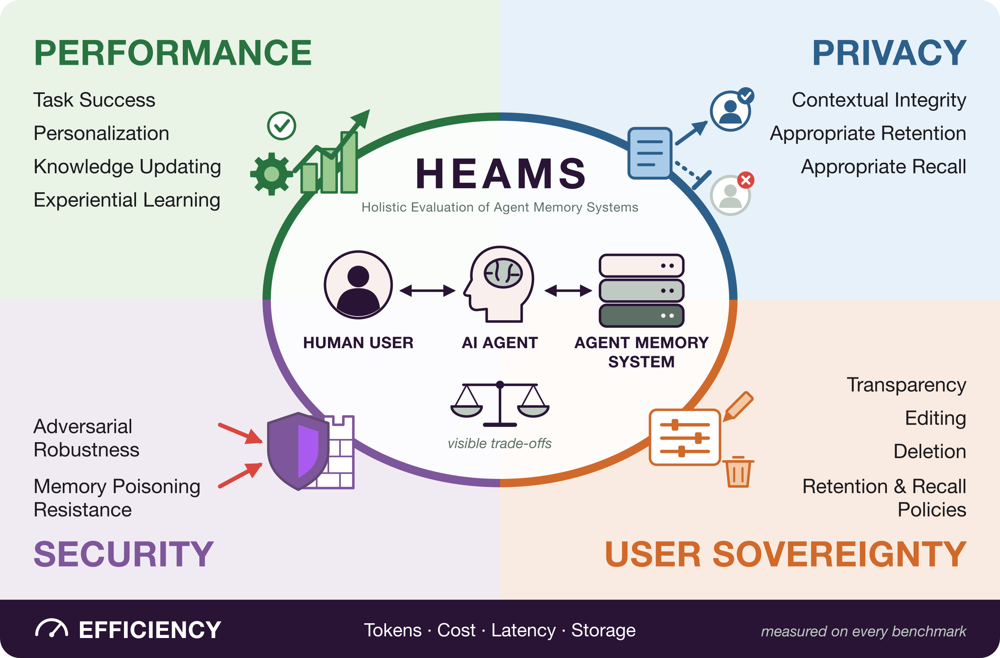

# HEAMS: Holistic Evaluation of Agent Memory Systems

  

HEAMS is an open framework for evaluating memory systems for AI agents
*holistically*. By *holistic* we mean the benchmarks provide coverage for the five dimensions shown in the figure above:

- **Performance**: task success, personalization, knowledge updating, and
  learning from experience.
- **Privacy**: ensuring that information is allowed to flow in accordance with contextual norms.
- **Security**: robustness to adversarial inputs and attacks.
- **User sovereignty**: transparency about what is stored, and the ability to
  edit it, delete it, and set retention and recall policies.
- **Efficiency**: tokens, cost, latency, and storage.

Each dimension is measured with its own metrics and reported side by side
rather than collapsed into a single score, so trade-offs stay visible. Memory
systems plug in through a common interface with the agent.
Agents, memory systems, and benchmarks are declared in YAML, so
comparing memory systems is a matter of listing more experiments in a run
config.

Documentation: <https://milatechtransfer.github.io/heams/>

## What's included

**Benchmarks**

| Benchmark | What it measures |
|---|---|
| [LoCoMo](python_package/docs/benchmarks/locomo.md) | Answering questions about very long, multi-session conversations |
| [BEAM](python_package/docs/benchmarks/beam.md) | Long-term memory abilities in conversations of 100K to 10M tokens |
| [MPBench](python_package/docs/benchmarks/mpbench.md) | Resistance to poisoned memories planted in the store |
| [LongMemEval](python_package/docs/benchmarks/long_mem_eval.md) | Recall over long, timestamped chat histories |
| [Evo-Memory (single-turn)](python_package/docs/benchmarks/evomemory_single_turn.md) | Reusing experience across ordered streams of tasks |
| [Transparency](python_package/docs/benchmarks/transparency.md) | Reporting accurately what is stored, without leaking unrelated memories |
| [Contextual Integrity](python_package/docs/benchmarks/contextual_integrity.md) | Sharing personal information only when the context makes it appropriate |
| [STALE](python_package/docs/benchmarks/stale.md) | Recognizing when a stored memory is out of date |
| [Erasability & Editability](python_package/docs/benchmarks/erasability_editability.md) | Deleting facts on request and propagating updates to dependent facts |
| [Retention policy](python_package/docs/benchmarks/retention_policy.md) | Blocking prohibited facts at ingest while keeping permitted ones recallable |

**Memory systems**

| Memory system | Kind | What it is |
|---|---|---|
| `in_context` | Built in | Recalls the most recent history that fits a token budget |
| `no_memory` | Built in | Stores nothing; the baseline |
| `milamem` | Plugin | Two-store memory with deduplication, conflict resolution, consolidation, and LLM-judged deletion |
| `mem0` | Plugin | Wraps [Mem0](https://github.com/mem0ai/mem0) |
| `hipporag` | Plugin | Wraps [HippoRAG 2](https://github.com/OSU-NLP-Group/HippoRAG) |
| `letta` | Plugin | Wraps a [Letta](https://github.com/letta-ai/letta) (MemGPT) agent; needs Postgres, see its [README](memory_plugins/heams_memory_letta/README.md) |
| `example.in_memory` | Plugin | Minimal example to copy when writing your own |

The privacy wrapper plugin adds retention and recall policies around any of
these; see its [README](memory_plugins/heams_memory_privacy_wrapper/README.md).

`make setup` installs all the plugins. Run `uv run heams memory list` (from
`python_package/`) to see what is installed, and see
[Memory backends](python_package/docs/memory-backends.md) for configuration.

## Getting started

Setup and usage are covered in the documentation:

- [Quick start](python_package/docs/index.md#quick-start): install, set your
  API keys, run the smoke tests and browse the results
- [Getting started](python_package/docs/getting-started.md): requirements,
  environment variables, how experiments and configs fit together, and the
  Makefile targets
- [CLI](python_package/docs/cli.md) and
  [Understanding results](python_package/docs/results.md): running your own
  experiments and reading their output
- [Adding a memory system](python_package/docs/adding-memory-system.md) and
  [Adding a benchmark](python_package/docs/adding-benchmark.md): extending the
  framework

## Citing

A paper describing the framework is in preparation. Until it is published,
please cite this repository if you use the framework in your research: use the
"Cite this repository" button on GitHub, or the metadata in
[`CITATION.cff`](CITATION.cff).

Please also cite the original paper of each benchmark you report. Several
benchmarks are adapted to this framework's shared setup, so report numbers as
obtained with this framework rather than comparing them directly with the
original papers. [Citations & credits](python_package/docs/citations.md) lists
every benchmark, dataset, and library used, with its paper, license, and BibTeX.

## License

This repository is released under the [MIT License](LICENSE), with two
exceptions. The datasets created for this project
(`python_package/datasets/retention_policy/` and
`python_package/datasets/transparency/seed.json`) are released under
[CC BY 4.0](https://creativecommons.org/licenses/by/4.0/). Third-party files
included in the repository, such as the small upstream excerpts used as test
fixtures, keep their original licenses.

Upstream benchmark datasets are downloaded from their original sources and keep
their own licenses; some restrict use (for example, LoCoMo is non-commercial and
BEAM is share-alike). Check
[Citations & credits](python_package/docs/citations.md) before using a dataset,
especially commercially.

## Funding

This framework was developed by the Applied Machine Learning Research Team at
[Mila – Quebec AI Institute](https://mila.quebec) in a 2026 research
collaboration funded by [Mozilla](https://www.mozilla.org).
The collaboration studies privacy and user control in memory for AI agents, and
the framework is released openly so others can run the same evaluations on
their own memory systems. The views expressed are those of the authors and do
not necessarily reflect those of Mozilla.

## Team

**Core team:** Jacob Lavoie, Chirag Goel, Jordan Bannister, Amirhossein
Naghshzan, and Arsène Fansi Tchango.

**Contributors:** Marzia Nouri (Contextual Integrity and Retention policy
benchmarks) and Mehar Bhatia (STALE and Erasability & Editability benchmarks).
See the
[contributors page](https://github.com/milatechtransfer/heams/graphs/contributors)
for everyone who has contributed code.

## Acknowledgements

We thank Matt Harris and the team at Mozilla for their guidance
and feedback throughout the collaboration, and our colleagues at Mila for their
supervision, project management, and feedback on the design and results of this
work.

## Contact

For questions, bug reports, and research collaborations, please open an
[issue on GitHub](https://github.com/milatechtransfer/heams/issues).
To contribute code, a benchmark, or a memory system, see
[CONTRIBUTING.md](CONTRIBUTING.md).
