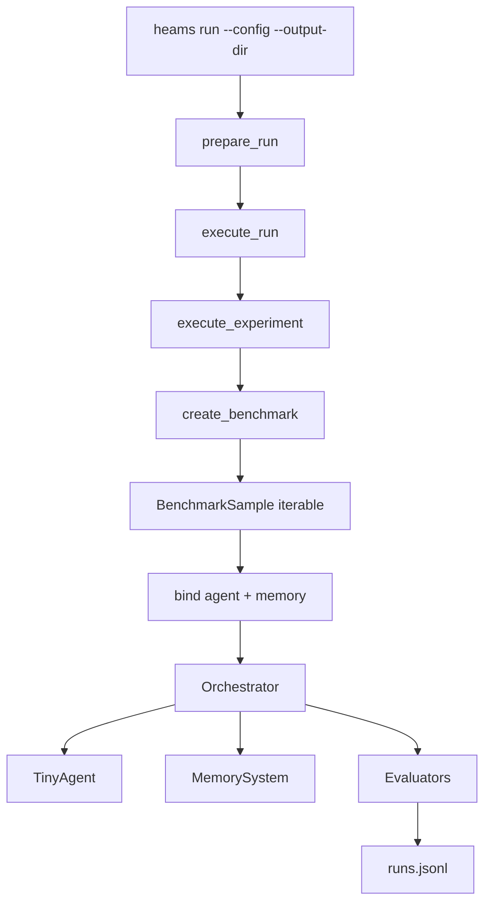
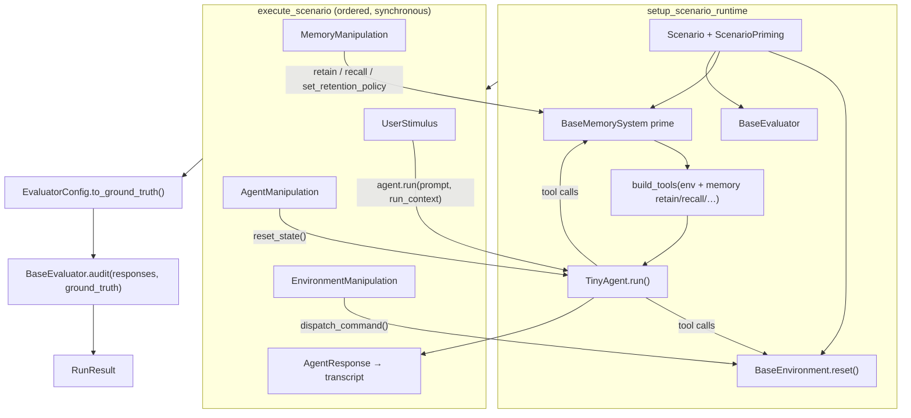

# Architecture

The harness is organized so campaigns are declared in YAML and each experiment
binds one agent, one memory system, and one benchmark before execution.



## Components

### `heams` CLI (`heams.cli.cli`)

Entry point for campaigns. Responsibilities:

- Parse the small subcommand surface (`run`, `memory list` / `memory test`,
  `generate-report`, `browse`)
- Load a run config from `configs/runs/`
- Hand a typed `ResolvedRunConfig` to the run orchestrator

No CLI overrides for model, memory, limits, or benchmark selection.

### Run and experiment orchestration (`heams.orchestration`)

| Module | Role |
|--------|------|
| `run_config` | `RunConfig` / `ExperimentConfig` / component refs |
| `run_orchestration` | Resolve component YAML, write run snapshot, execute experiments serially |
| `experiment_orchestration` | Materialize benchmark samples, bind components, run `Orchestrator` |
| `experiment_config` | `ResolvedExperimentExecutionConfig` (typed agent/memory/benchmark) |
| `orchestrator` | Scenario runtime: setup → execute → audit → teardown |
| `scenario_runtime` | `setup_scenario_runtime` / `teardown_scenario_runtime` |
| `scenario_execution` | `execute_scenario`: runs the execution sequence in order |

Each experiment is one agent/memory/benchmark tuple. Comparing memory backends
means listing multiple experiments in the run YAML, not sweeping inside one
experiment.

### Benchmark factories (`heams.benchmarks.factory`)

New-path benchmarks are typed configs with a `type` discriminator:

```text
BenchmarkConfig (discriminated by `type`: locomo, beam, mpbench, long_mem_eval,
                 evomemory_single_turn, transparency, ci, stale, ee, retention_policy)
    → BaseBenchmark → BenchmarkSample
```

New-path workloads inherit `BaseBenchmark`: their validated configuration
defines workload policy, they eagerly materialize ordered `BenchmarkSample`
objects, orchestration binds resolved agent and memory components, and runtime
executes the resulting `Scenario` objects. Each sample maps mechanically to a
scenario via `BenchmarkSample.to_scenario()`.

See [Adding a benchmark](adding-benchmark.md). Agents implementing a new suite
should load
[`.agents/skills/implement-benchmark/`](../../.agents/skills/implement-benchmark/)
(also linked under `.cursor/skills/` and `.claude/skills/`).

### Config ownership

| Owner | Examples |
|-------|----------|
| Agent config | `model_id`, instructions, `memory_strategy` |
| Memory-system config | backend `type`, `top_k`, file path, privacy wrapper |
| Benchmark config | dataset path, `limit` / `limit_stimuli`, task prompts |
| Run config | `run_name`, named experiment matrix |
| CLI invocation | resolved artifact output directory |
| Scenario data | stimuli, priming, ground truth — not agent/memory policy |

Benchmarks must not silently overwrite agent or memory policy at runtime. If a
setting is required for compatibility, validate it; keep the serialized
experiment config identical to what executes.

### Memory strategies

Agent memory access is selected by `memory_strategy`:

| Strategy | Access and write policy |
|----------|-------------------------|
| `no_memory` | No memory access. |
| `tool_use` | Agent-controlled recall and memory mutation tools. |
| `recall_only_tool_use` | Agent-controlled recall through the `recall` tool only. |
| `deterministic` | Framework-controlled recall injection and completed-turn retention. |
| `deterministic_with_delete` | Framework-controlled recall/retention plus explicit delete-intent routing through the memory backend. |
| `recall_only_deterministic` | Framework-controlled recall injection without completed-turn retention. |

### Orchestrator execution

Every run follows one synchronous **setup → execute → audit → teardown** path.
`setup_scenario_runtime` builds the optional environment, memory system,
tool-bound `TinyAgent`, and evaluator. `execute_scenario` then interprets
every `Scenario.execution_sequence` serially in declaration order.

`UserStimulus` calls stateful `agent.run`, while `EnvironmentManipulation`
dispatches to the active environment. `MemoryManipulation` calls the memory
system directly with `retain`, `recall`, or `set_retention_policy` (Retention
policy uses it), and `AgentManipulation` supports `reset_state` (Evo-Memory
uses it); other commands raise `ValueError`.



### Reporting

After a config-driven run:

- Per-experiment `runs.jsonl` and `run_status.json`
- Resolved config snapshots at run and experiment scope
- `heams generate-report` then writes a `report.md` per experiment; per-benchmark
  rollups are optional and generated from Python

How to read these: [Understanding results](results.md).

## Repository layout

| Path | Purpose |
|------|---------|
| `python_package/src/heams/` | Implementation (CLI, orchestration, benchmarks, memory, agents) |
| `python_package/datasets/` | Upstream datasets, downloaded on first use (not committed), and our own `retention_policy/` and `transparency/` datasets (committed) |
| `python_package/configs/agents/` | Agent component presets |
| `python_package/configs/memory_systems/` | Memory-system component presets |
| `python_package/configs/benchmarks/` | Benchmark component presets |
| `python_package/configs/runs/` | Campaign / run configs |
| `python_package/tests/` | Unit and orchestration smoke tests |
| `python_package/docs/` | This documentation site |
