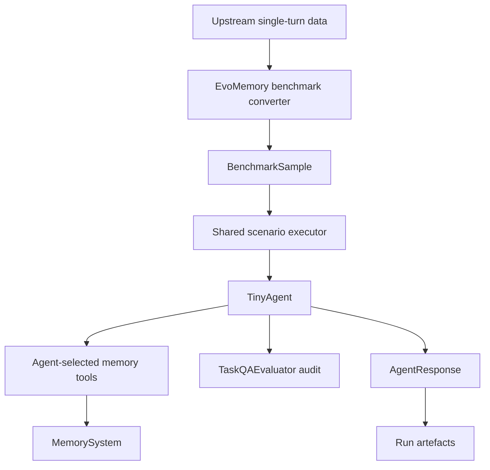

# Evo-Memory single-turn benchmark

`evomemory_single_turn` loads the upstream Evo-Memory single-turn datasets
(`aime_2024`, `gpqa_diamond`, `mmlu_pro`, and `toolbench`) from
`python_package/datasets/evomemory/single_turn/`, materializing missing source
files on first use. All four streams are required: materialization or loading
failure aborts the benchmark before model execution. The benchmark converter maps
upstream-native records into environment-free `BenchmarkSample` objects and
assigns each stream the `evomemory_single_turn_task_qa` evaluator with its
dataset-specific `match_mode`. LoCoMo remains
the static-memory long-context QA benchmark; Evo-Memory single-turn executes tasks
in order within each stream, allowing an agent that uses memory tools to reuse
memories it retained during earlier tasks.

Each task uses the following lifecycle before the next task begins:

```text
task -> unscored corrective feedback -> agent state reset -> next task
```

The corrective feedback is a `UserStimulus` containing the canonical target answer
exactly as supplied by the source dataset. It is a genuine agent turn: the agent
sees the preceding task and its submitted answer, may call configured memory tools
such as `retain`, then terminates through `final_answer` with the fixed
acknowledgement `Feedback recorded.` The feedback response is not a second answer
to the completed task.

After feedback, the declarative agent reset clears only ephemeral conversation
state. It does not clear, recreate, close, or otherwise alter the active external
memory system, so retained information remains available to later tasks through
configured deterministic recall or agent-selected memory tools. The reset itself
does not invoke the agent and creates no response, transcript entry, scored item,
or stimulus progress event. The Evo-Memory evaluator selects only original task
responses and delegates their official scoring to `TaskQAEvaluator` using the
dataset-owned match mode.

The benchmark config owns workload selection and limits. Evaluator modes are fixed
by the source stream. The agent config owns `memory_strategy`; the memory-system
config owns backend settings such as `top_k`. Runtime registers the declared memory
tools for a `tool_use` agent and does not alter either component configuration. The
framework does not recall, inject, score, or retain memory on the agent's behalf.



"Single-turn" describes the task shape. Memory behavior is selected only by the
configured agent and memory backend. Each source dataset is a separate
stream. External memory persists across all task-feedback-reset episodes within that
stream; scenario teardown retains its existing behavior and resets memory before the
next dataset begins. Because feedback uses the normal execution path, stimulus
counts, agent-turn counts, token usage, and per-stimulus efficiency metrics include
the feedback turns. Only original task turns contribute to benchmark accuracy.

## Run

```sh
uv run heams run \
    --config configs/runs/testing/evomemory_single_turn_smoke.yaml \
    --output-dir results/evomemory_single_turn_smoke
```

The smoke config limits execution to the first stream and its first two tasks. See
[CLI](../cli.md) for shared options and results layout.

## Source and license

Evo-Memory is by Wei et al., 2025
([arXiv:2511.20857](https://arxiv.org/abs/2511.20857)). The four single-turn
streams are built from upstream datasets, each under its own license:

| Stream | Source | License |
|---|---|---|
| `aime_2024` | [`HuggingFaceH4/aime_2024`](https://huggingface.co/datasets/HuggingFaceH4/aime_2024) | Not stated on the dataset card |
| `gpqa_diamond` | [`Idavidrein/gpqa`](https://huggingface.co/datasets/Idavidrein/gpqa) (gated: accept its terms on Hugging Face first) | CC BY 4.0 |
| `mmlu_pro` | [`TIGER-Lab/MMLU-Pro`](https://huggingface.co/datasets/TIGER-Lab/MMLU-Pro) | MIT |
| `toolbench` | Berkeley Function Calling Leaderboard files from [`ShishirPatil/gorilla`](https://github.com/ShishirPatil/gorilla) (BFCL, Patil et al., 2025; Gorilla, Patil et al., 2023) | Apache-2.0 |

They are downloaded on first use and not redistributed in this repository.
See [Citations & credits](../citations.md) for BibTeX.
